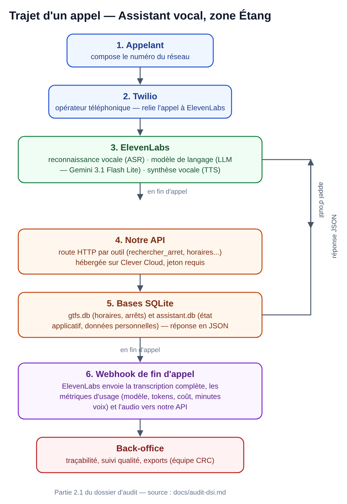

# Annexes — Dossier d'audit DSI, Assistant vocal zone Étang

Document complémentaire à `docs/audit-dsi.md`, référencé par sa dernière ligne (« Suite prévue : annexes »). Même principe de rigueur que le dossier principal : chaque affirmation vient d'un fichier réel du dépôt ou d'une vérification directe.

---

## Annexe A — Glossaire

| Terme | Définition |
|---|---|
| **GTFS** (*General Transit Feed Specification*) | Format ouvert standard pour décrire les horaires et le réseau d'un transport public (arrêts, lignes, horaires). C'est le format source des données de ce projet. |
| **GTFS-RT** | Extension temps réel du GTFS (retards, perturbations). Non utilisée dans ce projet — voir `docs/sources.md`, « Temps réel — reporté en v1 ». |
| **Webhook** | Mécanisme par lequel un service externe (ici ElevenLabs) envoie automatiquement une information à notre API dès qu'un événement survient (fin d'un appel, par exemple) — l'inverse d'un appel que l'on initierait nous-mêmes. |
| **ASR** (*Automatic Speech Recognition*) | Reconnaissance vocale : transformer la voix de l'appelant en texte. Assurée par ElevenLabs (modèle Scribe). |
| **TTS** (*Text-to-Speech*) | Synthèse vocale : transformer le texte généré par le modèle de langage en voix audible par l'appelant. Assurée par ElevenLabs. |
| **LLM** (*Large Language Model*, modèle de langage) | Le modèle d'intelligence artificielle qui comprend ce que dit l'appelant, décide quoi répondre et quels outils appeler. Actuellement Gemini 3.1 Flash Lite (Google), hébergé et orchestré par ElevenLabs. |
| **API REST** | Interface par laquelle deux programmes communiquent via des requêtes HTTP standard. C'est ainsi qu'ElevenLabs appelle nos outils, et que notre API interroge Google Routes. |
| **Jeton (token) / Bearer** | Secret transmis dans chaque requête pour prouver qu'on a le droit d'appeler une route protégée — ici `API_TOKEN`, envoyé dans l'en-tête `Authorization: Bearer ...`. |
| **Pydantic** | Bibliothèque Python utilisée par FastAPI pour décrire et vérifier automatiquement la forme attendue de chaque donnée (type, longueur, format) avant qu'elle n'atteigne le code métier. |
| **SQLite** | Système de base de données fonctionnant comme un simple fichier, sans serveur à administrer séparément — choix du projet pour rester simple à exploiter. |
| **HMAC** | Mécanisme de signature cryptographique permettant de vérifier qu'un message (ici, un webhook) provient bien de l'expéditeur attendu et n'a pas été falsifié. Proposé par ElevenLabs mais pas encore utilisé dans ce projet (voir Partie 5.4 du dossier principal). |
| **Comparaison en temps constant** | Technique de comparaison de deux secrets (ex. deux jetons) qui prend toujours le même temps, quel que soit le point où ils diffèrent — évite qu'un attaquant devine un secret caractère par caractère en mesurant les temps de réponse. |
| **RGPD** | Règlement général sur la protection des données — cadre légal européen encadrant la collecte et le traitement des données personnelles. |
| **DPO** (*Data Protection Officer*, délégué à la protection des données) | Personne désignée pour s'assurer du respect du RGPD au sein d'une organisation. |
| **AIPD** (analyse d'impact relative à la protection des données, *DPIA* en anglais) | Étude formelle requise par le RGPD pour les traitements de données présentant un risque élevé pour les personnes concernées. |
| **Sous-traitant** (au sens RGPD) | Un prestataire qui traite des données personnelles pour le compte d'un responsable de traitement (ici, par exemple, ElevenLabs ou Twilio). |
| **Donnée personnelle** | Toute information se rapportant à une personne physique identifiée ou identifiable (nom, téléphone, voix enregistrée, etc.). |
| **Base légale** | Le fondement juridique du RGPD qui justifie un traitement de données personnelles (consentement, exécution d'un contrat, intérêt légitime...). |
| **Minimisation des données** | Principe RGPD : ne collecter et ne conserver que les données strictement nécessaires à la finalité poursuivie. |
| **Rétention / purge** | Durée pendant laquelle une donnée est conservée, et mécanisme qui la supprime automatiquement une fois ce délai dépassé. |
| **Licence Ouverte 2.0** | Licence française de réutilisation libre des données publiques (Etalab), sous laquelle sont publiées les données GTFS utilisées par ce projet. |
| **Commune (déduite)** | Dans ce projet, la commune d'un arrêt n'est pas fournie nativement par le GTFS : elle est recalculée à partir des coordonnées GPS de l'arrêt (voir `assistant/ingestion/enrichir_commune.py`). |
| **Embeddings** | Représentation numérique d'un texte (un vecteur de nombres) qui permet de mesurer la similarité de sens entre deux phrases — utilisée pour la recherche dans la base de connaissance. |
| **Index documentaire** | Dans ce projet, le fichier `data/corpus_index.json` : le résultat pré-calculé des embeddings de toute la base de connaissance, pour une recherche rapide sans recalcul à chaque question. |
| **Back-office** | L'interface web réservée à l'équipe (pas aux appelants) pour consulter les appels, gérer l'activation des outils, exporter des données. |
| **CRC** | Centre de relation client — l'équipe qui répond aujourd'hui au téléphone et dont la grille de classification des sujets a servi de référence pour structurer les outils de l'assistant. |
| **POC** (*Proof of Concept*) | Démonstrateur technique visant à vérifier la faisabilité d'une idée, avant un développement à plus grande échelle — le stade actuel de ce projet. |
| **Pilote** | Étape suivant le POC : un test grandeur réelle avec de vrais appelants, sur un périmètre limité (ici, une filiale), avant un déploiement plus large. |

---

## Annexe B — Références officielles

### Spécifications et standards techniques

- Spécification GTFS (format statique) : [gtfs.org/schedule/reference](https://gtfs.org/schedule/reference/)
- Documentation FastAPI : [fastapi.tiangolo.com](https://fastapi.tiangolo.com/)
- Documentation Pydantic : [docs.pydantic.dev](https://docs.pydantic.dev/)

### Fournisseurs du projet (voir Partie 2.4 du dossier principal)

- ElevenLabs — documentation Conversational AI : [elevenlabs.io/docs/conversational-ai](https://elevenlabs.io/docs/conversational-ai)
- Twilio — documentation : [www.twilio.com/docs](https://www.twilio.com/docs)
- Google Routes API : [developers.google.com/maps/documentation/routes](https://developers.google.com/maps/documentation/routes)
- Clever Cloud — documentation : [www.clever-cloud.com/developers/doc](https://www.clever-cloud.com/developers/doc/)
- API Adresse (data.gouv.fr, gouvernement français) : [api-adresse.data.gouv.fr](https://api-adresse.data.gouv.fr/)

### Sources de données

- Flux GTFS du réseau (Mecatran, via la Métropole Mobilité) : `https://app.mecatran.com/utw/ws/gtfsfeed/static/mamp-bde?apiKey=***REDACTÉ***` — **point de vigilance signalé ici en préparant cette annexe** : la clé figure en clair dans `docs/sources.md`, versionné, en plus de `data/config.yaml` déjà signalé Partie 5.3 du dossier principal — même correctif à appliquer aux deux fichiers.
- Page de détail du jeu de données : [transport.data.gouv.fr/resources/39597](https://transport.data.gouv.fr/resources/39597)
- Contours communaux (déduction de la commune d'un arrêt) : [github.com/gregoiredavid/france-geojson](https://github.com/gregoiredavid/france-geojson)
- Licence Ouverte 2.0 (Etalab) : [www.etalab.gouv.fr/licence-ouverte-open-licence](https://www.etalab.gouv.fr/licence-ouverte-open-licence-agreement/)

### RGPD

- Texte officiel du RGPD (Règlement UE 2016/679) : [eur-lex.europa.eu/eli/reg/2016/679](https://eur-lex.europa.eu/eli/reg/2016/679/oj?locale=fr)
- CNIL — guide de l'analyse d'impact relative à la protection des données (AIPD) : [www.cnil.fr/fr/RGPD-analyse-impact-protection-des-donnees-pia](https://www.cnil.fr/fr/RGPD-analyse-impact-protection-des-donnees-pia)
- CNIL — sous-traitance et RGPD : [www.cnil.fr/fr/sous-traitance](https://www.cnil.fr/fr/sous-traitance)

### Documents internes du projet

- `CLAUDE.md` — les règles non négociables du projet, dictées par l'utilisateur
- `docs/spec-assistant-vocal-v0-revisee.md` — le prompt système de l'agent et le contrat exact de chaque outil
- `docs/sources.md` — inventaire complet des sources de données évaluées
- `docs/methode-developpement.md` — la méthode de travail actée avant la première ligne de code
- `docs/methode-amelioration-continue.md` — le mécanisme de remontée des besoins par l'équipe CRC
- `docs/prochaines-etapes.md` — le journal de bord complet du projet

---

## Annexe C — Extraits de code complets

Sélection de fichiers courts, cités dans le dossier principal mais seulement décrits narrativement — pour que l'audit puisse lire le code réel sans ouvrir le dépôt.

### C.1 — Authentification (`assistant/api/auth.py`)

Référencé en Partie 5.1 (« Authentification par jeton »). Fichier complet :

```python
"""
Authentification par jeton bearer. Le jeton attendu vit dans .env
(jamais dans le dépôt) sous la clé API_TOKEN.

Chaque appel à l'API doit envoyer l'en-tête :
    Authorization: Bearer <API_TOKEN>

Le back-office utilise un mot de passe séparé (BACKOFFICE_MOT_DE_PASSE),
volontairement distinct d'API_TOKEN depuis le 29/09/2026 (voir
docs/audit-dsi.md, partie 5.4) : API_TOKEN circule par nature dans des
endroits publics ou semi-publics (en-têtes d'outils ElevenLabs, URL de
webhook, captures d'écran de configuration) ; le compromettre ne doit
jamais donner accès aux journaux d'appels du back-office.
"""

import os
import secrets

from dotenv import load_dotenv
from fastapi import Depends, Header, HTTPException
from fastapi.security import HTTPBasic, HTTPBasicCredentials

load_dotenv()

API_TOKEN = os.environ.get("API_TOKEN")
BACKOFFICE_MOT_DE_PASSE = os.environ.get("BACKOFFICE_MOT_DE_PASSE")

if not API_TOKEN:
    raise RuntimeError(
        "API_TOKEN absent de l'environnement. Vérifie que .env existe et "
        "contient API_TOKEN=... (voir .env, jamais commité)."
    )

if not BACKOFFICE_MOT_DE_PASSE:
    raise RuntimeError(
        "BACKOFFICE_MOT_DE_PASSE absent de l'environnement. Choisis un mot "
        "de passe indépendant d'API_TOKEN et ajoute-le à .env (jamais "
        "commité) et aux variables d'environnement Clever Cloud."
    )


def verifier_jeton(authorization: str = Header(default=None)):
    attendu = f"Bearer {API_TOKEN}"
    if not authorization or not secrets.compare_digest(authorization, attendu):
        raise HTTPException(status_code=401, detail="Jeton d'authentification invalide ou absent")


def verifier_jeton_requete(jeton: str = None):
    """Même vérification, mais via un paramètre d'URL (?jeton=...) plutôt
    qu'un en-tête : pour le webhook ElevenLabs, dont la configuration ne
    permet pas forcément d'ajouter un en-tête personnalisé, contrairement
    aux outils qu'on déclare nous-mêmes."""
    if not jeton or not secrets.compare_digest(jeton, API_TOKEN):
        raise HTTPException(status_code=401, detail="Jeton d'authentification invalide ou absent")


_basic = HTTPBasic()


def verifier_acces_backoffice(identifiants: HTTPBasicCredentials = Depends(_basic)):
    """Protection de la page de back-office (identifiant/mot de passe
    classiques dans le navigateur), avec BACKOFFICE_MOT_DE_PASSE — jamais
    API_TOKEN, qui circule dans des endroits bien moins protégés (voir
    docstring du module)."""
    mot_de_passe_ok = secrets.compare_digest(identifiants.password, BACKOFFICE_MOT_DE_PASSE)
    utilisateur_ok = secrets.compare_digest(identifiants.username, "crc")
    if not (mot_de_passe_ok and utilisateur_ok):
        raise HTTPException(
            status_code=401, detail="Accès refusé",
            headers={"WWW-Authenticate": "Basic"},
        )
```

### C.2 — Validation des entrées (`assistant/api/schemas.py`, extraits)

Référencé en Partie 5.1 (« Validation stricte de toutes les entrées »). Deux extraits représentatifs : le validateur de numéro de téléphone, et son usage sur le contrat de `enregistrer_objet_perdu`.

```python
# Un min_length=1 ne suffit pas : un modèle peut inventer une valeur non
# vide mais fictive plutôt que de poser la question ("0000000000", vu le
# 28/09/2026 avec Gemini 3.1 Flash Lite sur enregistrer_objet_perdu — voir
# docs/prochaines-etapes.md). On valide donc la forme d'un vrai numéro
# français : 10 chiffres, commence par 0, le deuxième chiffre n'est pas 0.
_RE_TELEPHONE = re.compile(r"0[1-9]\d{8}$")


def _valider_telephone(valeur: str) -> str:
    nettoye = re.sub(r"[ .\-]", "", valeur)
    if not _RE_TELEPHONE.fullmatch(nettoye):
        raise ValueError("numéro de téléphone invalide (attendu : 10 chiffres, format français)")
    return valeur
```

```python
class ObjetPerduRequete(BaseModel):
    nature: str
    description: str
    ligne: Optional[str] = None
    sens: Optional[str] = None
    date_perte: str
    creneau_horaire: str
    lieu: Literal["a_bord", "arret", "agence", "incertain"]
    arret_id: Optional[str] = None
    # min_length=1 : sans ça, rien n'empêche un modèle d'appeler l'outil
    # avant d'avoir demandé nom/téléphone à l'appelant (bug GPT-6 Luna du
    # 28/09/2026, voir docs/prochaines-etapes.md) — la validation renvoie
    # une 422 plutôt que d'enregistrer une déclaration inexploitable.
    nom: str = Field(min_length=1)
    telephone: str = Field(min_length=1)
    email: Optional[str] = None
    opt_in_marketing: bool

    _valider = field_validator("telephone")(_valider_telephone)
```

### C.3 — Schéma des données personnelles (`assistant/outils/db.py`, extrait)

Référencé en Partie 6.1 (« Données personnelles collectées »). Les tables de `data/etat/assistant.db`, dans leur définition SQL exacte :

```python
_SCHEMA_APP = """
CREATE TABLE IF NOT EXISTS objets_perdus (
    id INTEGER PRIMARY KEY AUTOINCREMENT,
    cree_le TEXT NOT NULL,
    nature TEXT NOT NULL,
    description TEXT NOT NULL,
    ligne TEXT,
    sens TEXT,
    date_perte TEXT NOT NULL,
    creneau_horaire TEXT NOT NULL,
    lieu TEXT NOT NULL,
    arret_id TEXT,
    nom TEXT NOT NULL,
    telephone TEXT NOT NULL,
    email TEXT,
    opt_in_marketing INTEGER NOT NULL
);

CREATE TABLE IF NOT EXISTS demandes_rappel (
    id INTEGER PRIMARY KEY AUTOINCREMENT,
    cree_le TEXT NOT NULL,
    telephone TEXT NOT NULL,
    nom TEXT,
    email TEXT,
    motif TEXT NOT NULL,
    resume TEXT NOT NULL,
    opt_in_marketing INTEGER NOT NULL
);

CREATE TABLE IF NOT EXISTS transferts (
    id INTEGER PRIMARY KEY AUTOINCREMENT,
    cree_le TEXT NOT NULL,
    motif TEXT NOT NULL,
    resume TEXT NOT NULL
);

-- Étape 6 : historique des appels, alimenté par le webhook de fin
-- d'appel envoyé par ElevenLabs. donnees_brutes conserve la charge
-- complète telle que reçue (voir assistant/backoffice/appels.py).
CREATE TABLE IF NOT EXISTS appels (
    id INTEGER PRIMARY KEY AUTOINCREMENT,
    cree_le TEXT NOT NULL,
    conversation_id TEXT UNIQUE,
    agent_id TEXT,
    statut TEXT,
    donnees_brutes TEXT NOT NULL
);

CREATE TABLE IF NOT EXISTS activation_outils (
    outil TEXT PRIMARY KEY,
    actif INTEGER NOT NULL DEFAULT 1
);

CREATE TABLE IF NOT EXISTS evaluations_appels (
    id INTEGER PRIMARY KEY AUTOINCREMENT,
    appel_id INTEGER NOT NULL,
    cree_le TEXT NOT NULL,
    qualite TEXT NOT NULL CHECK (qualite IN ('bonne', 'mauvaise')),
    note TEXT
);

CREATE TABLE IF NOT EXISTS regles_prononciation (
    grapheme TEXT PRIMARY KEY,
    alias TEXT NOT NULL,
    cree_le TEXT NOT NULL
);

-- Satisfaction déclarée par l'appelant lui-même (à distinguer de
-- evaluations_appels, qui est l'avis de l'équipe a posteriori).
CREATE TABLE IF NOT EXISTS satisfaction_appels (
    conversation_id TEXT PRIMARY KEY,
    satisfait INTEGER NOT NULL,
    cree_le TEXT NOT NULL
);

-- SMS envoyés avec le détail d'un itinéraire complexe. texte : conservé
-- tel quel, reconstruit côté serveur, jamais composé par le LLM
-- (CLAUDE.md, exactitude).
CREATE TABLE IF NOT EXISTS sms_envoyes (
    id INTEGER PRIMARY KEY AUTOINCREMENT,
    cree_le TEXT NOT NULL,
    telephone TEXT NOT NULL,
    texte TEXT,
    succes INTEGER NOT NULL,
    erreur TEXT,
    conversation_id TEXT
);

CREATE TABLE IF NOT EXISTS parametres (
    cle TEXT PRIMARY KEY,
    valeur TEXT NOT NULL
);
"""
```

### C.4 — Purge automatique des transcripts (`assistant/backoffice/appels.py`, extrait)

Référencé en Partie 6.4 (« Durées de conservation »). La fonction appelée au démarrage puis une fois par jour :

```python
def purger_transcripts_expires():
    """Vide donnees_brutes (transcript intégral, numéro de l'appelant...)
    des appels plus vieux que DUREE_RETENTION_DONNEES_BRUTES_JOURS.
    Ne touche ni la ligne elle-même ni les colonnes de métriques déjà
    extraites. Idempotent : les lignes déjà vidées ('{}') ne sont pas
    réécrites inutilement."""
    seuil = (
        datetime.now(_FUSEAU).replace(tzinfo=None) - timedelta(days=DUREE_RETENTION_DONNEES_BRUTES_JOURS)
    ).isoformat(timespec="seconds")
    conn = connexion_app()
    conn.execute(
        "UPDATE appels SET donnees_brutes = '{}' WHERE cree_le < ? AND donnees_brutes != '{}'",
        (seuil,),
    )
    conn.commit()
    conn.close()
```

### C.5 — Activation progressive des outils (`assistant/backoffice/activation.py`)

Référencé en Partie 7.2. Fichier complet :

```python
"""
Activation progressive des outils — pouvoir n'ouvrir qu'un seul cas
d'usage au départ, puis les autres au fil des semaines, plus un
interrupteur général pour tout couper d'un coup.

Le choix technique : un outil désactivé renvoie une erreur HTTP (503),
pas une réponse habillée en "rien trouvé" — vérifié en conditions
réelles : à chaque fois qu'un outil a échoué techniquement (404, 422...),
l'agent vocal a basculé proprement vers la sortie sans jamais inventer
de réponse. On réutilise ce comportement déjà éprouvé.
"""

from fastapi import HTTPException

from assistant.outils.db import NOMS_OUTILS, connexion_app


def est_actif(outil):
    conn = connexion_app()
    ligne_generale = conn.execute(
        "SELECT actif FROM activation_outils WHERE outil = 'tous'"
    ).fetchone()
    ligne_outil = conn.execute(
        "SELECT actif FROM activation_outils WHERE outil = ?", (outil,)
    ).fetchone()
    conn.close()
    if not ligne_generale or not ligne_generale["actif"]:
        return False
    return bool(ligne_outil and ligne_outil["actif"])


def basculer(outil):
    """Inverse l'état actif/inactif de outil ('tous' ou un nom d'outil)."""
    conn = connexion_app()
    conn.execute(
        "UPDATE activation_outils SET actif = 1 - actif WHERE outil = ?", (outil,)
    )
    conn.commit()
    conn.close()


def verifier_outil_actif(nom_outil):
    """Fabrique une dépendance FastAPI pour un outil donné : à utiliser
    comme Depends(verifier_outil_actif("rechercher_arret")) sur chaque
    route d'outil."""
    def dependance():
        if not est_actif(nom_outil):
            raise HTTPException(
                status_code=503,
                detail=f"{nom_outil} temporairement désactivé depuis le back-office",
            )
    return dependance
```

---

## Annexe D — Schéma : trajet d'un appel

Illustration de la Partie 2.1 du dossier principal.



---

*Fin des annexes.*
